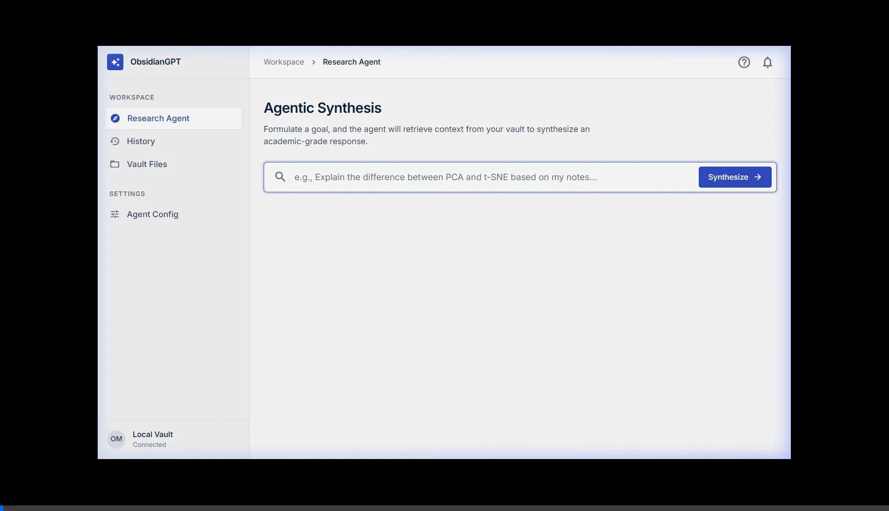

# ObsidianGPT 🔮

**ObsidianGPT** is an elite, academically rigorous, productivity-maximizing second-brain assistant deeply embedded inside your local Obsidian vault. It acts as an autonomous knowledge synthesizer that strictly relies on the context of your personal notes — avoiding hallucinations and ensuring high-signal reasoning.



## 🌟 Key Features
- **Local-First Inference:** Powered by `ollama` (default: `qwen3:1.7b`). Your vault data never leaves your machine — unless you opt into a cloud provider (Anthropic, OpenAI, Gemini or any OpenAI-compatible API) by setting its API key.
- **Smart Retrieval:** Cosine-similarity BM25 chunked retrieval with a relevance threshold — only genuinely matching notes are returned, eliminating noise from unrelated topics.
- **Agentic Synthesis Pipeline:** Dynamically plans execution steps, retrieves relevant chunks from your `.md` files, and synthesizes answers using academic-grade reasoning.
- **Enterprise Web Workspace:** A polished, multi-view Single Page Application (SPA) natively integrated with FastAPI, offering:
  - **Research Agent:** Formulate goals and view retrieved evidence.
  - **Session History:** Review past reasoning runs in the current session.
  - **Vault Files:** Live indexing of available context notes.
  - **Agent Config:** On-the-fly tuning of models and chunk limits.
- **Obsidian-Native Output:** Understands and generates perfect Obsidian Markdown (`[[wikilinks]]`, `#tags`, YAML frontmatter, `$math$`).

## 🚀 Installation

ObsidianGPT requires Python 3.10+, a configured vault, and [Ollama](https://ollama.com) running locally.

1. Clone the repository:
```bash
git clone https://github.com/mostaphaelansari/ObsidianGPT-.git
cd ObsidianGPT-
```
2. Install the package and dependencies:
```bash
pip install -e .
```
3. Pull the default local model:
```bash
ollama pull qwen3:1.7b
```
4. Set your environment variables in a `.env` file:
```ini
VAULT_PATH="C:/path/to/your/obsidian/vault"
OLLAMA_MODEL=qwen3:1.7b
OLLAMA_HOST=http://localhost:11434
```

### Using a cloud provider instead of Ollama (optional)

Set one provider's API key and ObsidianGPT uses it instead of Ollama. Install that provider's SDK too:

| Provider | Install | `.env` | Default model |
|---|---|---|---|
| Anthropic | `pip install -e .[anthropic]` | `ANTHROPIC_API_KEY=...` | `claude-opus-5-5` |
| OpenAI | `pip install -e .[openai]` | `OPENAI_API_KEY=...` | `gpt-5-mini` |
| Gemini | `pip install -e .[gemini]` | `GEMINI_API_KEY=...` | `gemini-2.5-flash` |

- Override the model with `ANTHROPIC_MODEL`, `OPENAI_MODEL` or `GEMINI_MODEL`, the `--model` CLI flag, or the model field in Agent Config.
- Any OpenAI-compatible API (OpenRouter, Groq, Together, LM Studio…) works through the OpenAI provider: set `OPENAI_BASE_URL` with that service's key in `OPENAI_API_KEY`.
- If several keys are set, the first wins (Anthropic → OpenAI → Gemini). Set `LLM_PROVIDER=anthropic|openai|gemini|ollama` to choose explicitly.
- If the cloud call fails, ObsidianGPT falls back to Ollama, then to offline template mode.

See [.env.example](.env.example) for all options.

## 🛠️ Usage

### 1. Start Ollama
```bash
ollama serve
```

### 2. Enterprise Web Workspace
Launch the FastAPI web server to access the GUI:
```powershell
uvicorn obsidiangpt.server:app --port 8000
```
Then navigate to `http://localhost:8000` in your browser.

### 3. Command Line Interface (CLI)
Query your vault directly from the terminal:
```bash
obsidiangpt "What is the difference between supervised and unsupervised learning?"
```
This will parse the vault, execute the reasoning pipeline, and output a structured `Synthesis.md` file directly into your vault's `_obsidiangpt/` folder.

## 🗺️ Future Development / Roadmap
- **Semantic Vector Store (Embeddings):** Upgrade the current BM25 retrieval to utilize local dense embedding models (e.g., `sentence-transformers`) and a vector database like ChromaDB or FAISS for deep semantic search.
- **Graph-Aware Retrieval:** Native integration with Obsidian's internal backlink graph — dynamically pull in 1-step linked neighbors for deeper context.
- **Continuous Chat / Memory:** Expand the UI from a one-shot "Goal → Synthesis" pipeline into a stateful chat interface with conversational follow-ups.
- **Direct Vault Write-Back:** Automatically format, tag, and save the generated synthesis as a pristine Zettelkasten note back into your vault.
- **Multi-Agent Verification Pipeline:** A localized "Fact-Checker" sub-agent that verifies the synthesis against retrieved chunks to guarantee zero-hallucination compliance.

---
**ObsidianGPT** — Function over form. Zero hallucination. High-signal output.
